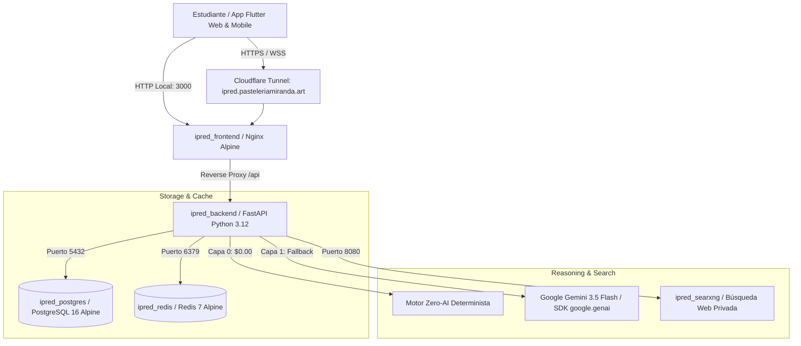

# 🚀 Guía de Operación Docker, Base de Datos y Arquitectura de IA
> **Documento Maestro para Agentes IA y Desarrolladores**  
> **Proyecto:** IPRED Chatbot UIS (Sistema Inteligente de Orientación Académica y Llamadas de Voz)  
> **Última Actualización:** Septiembre 2026

---

## 🏛️ 1. Arquitectura General del Sistema

El proyecto opera como un clúster de microservicios contenerizados mediante **Docker Compose**, optimizado para latencia mínima ($< 50\text{ ms}$ en Capa 0 Zero-AI) y consumo eficiente de tokens.



---

## 📦 2. Servicios Docker y Puertos

| Contenedor | Imagen Base | Puerto Host | Descripción | Healthcheck |
| :--- | :--- | :--- | :--- | :--- |
| **`ipred_frontend`** | `nginx:alpine` (Multi-stage Flutter) | `3000` | Frontend Flutter Web optimizado con Proxy Inverso Nginx | `wget -q --spider http://localhost/` |
| **`ipred_backend`** | `python:3.12-slim` | `8000` | API REST FastAPI, autenticación JWT, orquestador de IA | `curl -f http://localhost:8000/docs` |
| **`ipred_postgres`** | `postgres:16-alpine` | `5432` | Base de datos relacional con extensión `pg_trgm` y FTS en español | `pg_isready -U ipred_user -d ipred_chatbot` |
| **`ipred_redis`** | `redis:7-alpine` | `6379` | Caché en memoria L2 y limitador de tasa de peticiones | `redis-cli ping` |
| **`ipred_searxng`** | `searxng/searxng` | `8080` | Metabuscador privado para búsquedas en el portal UIS | `curl http://localhost:8080/` |
| **`ipred_cloudflare_tunnel`** | `cloudflare/cloudflared` | N/A | Túnel seguro HTTPS de acceso global sin abrir puertos en router | Conexión activa a Cloudflare |

---

## 🗄️ 3. Base de Datos PostgreSQL y Persistencia

### 📍 Volúmenes Persistentes
Los datos nunca se pierden al reiniciar Docker o el PC gracias a los volúmenes nombrados:
* `ipred_postgres_data` $\to$ `/var/lib/postgresql/data` (Datos de PostgreSQL).
* `ipred_redis_data` $\to$ `/data` (Persistencia Redis Append-Only File `AOF`).
* `ipred_backend_data` $\to$ `/app/data` (Logs y respaldos de sincronización).
* `ipred_searxng_data` $\to$ `/var/lib/searxng`.

### 📊 Esquema de Tablas
El archivo de esquema inicial reside en [`backend/database_schema_postgres.sql`](file:///c:/Users/Juan/.gemini/antigravity-ide/scratch/ipred-chatbot/backend/database_schema_postgres.sql) y se aplica automáticamente en el primer arranque:
1. `usuarios`: Credenciales de acceso, contraseñas hasheadas con `bcrypt`, roles (`estudiante`, `admin`).
2. `estudiantes`: Perfiles académicos vinculados a códigos UIS (ej. `2226666`, `2226669`), sedes y programas.
3. `docentes`: Directorio de profesores y correos institucionales `@uis.edu.co`.
4. `asignaturas`: Catálogo de asignaturas con código, créditos y grupos.
5. `estudiante_asignaturas`: Matrícula académica activa del semestre.
6. `horarios_tutorias`: **20.508 registros de tutorías y clases** sincronizados con fecha, hora, modalidad y aula.
7. `conversaciones` y `mensajes`: Historial de chats y llamadas por usuario.
8. `informacion_fija`: Base de conocimiento institucional con índice Full Text Search (FTS) en español.

---

## ⚡ 4. Cómo Levantar el Sistema tras un Reinicio del PC

Para un Agente de IA o desarrollador que acaba de reiniciar el computador:

### Paso 1: Asegurarse que Docker Desktop esté en ejecución
Comprobar en terminal:
```powershell
docker info
```

### Paso 2: Verificar el archivo de variables de entorno `.env`
El archivo `.env` debe existir en la raíz del proyecto ([`.env`](file:///c:/Users/Juan/.gemini/antigravity-ide/scratch/ipred-chatbot/.env)). Contiene:
```env
FRONTEND_PORT=3000
BACKEND_PORT=8000
POSTGRES_PORT=5432
REDIS_PORT=6379
SEARXNG_PORT=8080

POSTGRES_USER=ipred_user
POSTGRES_PASSWORD=ipred_secure_password_2026!
POSTGRES_DB=ipred_chatbot

REDIS_PASSWORD=ipred_redis_pass_2026!

GEMINI_API_KEY=tu_api_key_aqui
GEMINI_MODEL=gemini-3.5-flash-lite

JWT_SECRET=dev-secret-change-in-production-32chars!
JWT_ALGORITHM=HS256
JWT_ACCESS_TOKEN_EXPIRE_MINUTES=43200
```

### Paso 3: Iniciar todos los contenedores en segundo plano
```powershell
docker compose up -d
```
*(O alternativamente ejecutar el script [`start_ipred.bat`](file:///c:/Users/Juan/.gemini/antigravity-ide/scratch/ipred-chatbot/start_ipred.bat))*.

### Paso 4: Validar el estado de salud de los servicios
```powershell
docker ps
```
Todos los contenedores deben figurar en estado `Up (healthy)`.

---

## 🔄 5. Modos de Desarrollo y Recarga en Caliente (Hot-Reload)

* **Backend FastAPI:**
  El directorio `./backend/app` está montado como volumen bind en vivo en `/app/app`. **Cualquier cambio en el código Python de backend se recarga instantáneamente en 0 segundos** sin reiniciar Docker (`uvicorn --reload`).
* **Frontend Flutter Web:**
  Si realizas cambios en `frontend/lib/`, para regenerar el bundle de producción en Nginx:
  ```powershell
  docker compose build ipred_frontend; docker compose up -d ipred_frontend
  ```

---

## 🧪 6. Suites de Pruebas Automatizadas

Cualquier IA que retome el proyecto puede verificar la integridad con los siguientes comandos:

### 1. Suite de Pruebas de Inteligencia Artificial (Backend - 8 Escenarios)
```powershell
docker cp backend/test_ai_suite.py ipred_backend:/app/test_ai_suite.py
docker exec ipred_backend python /app/test_ai_suite.py
```
*Valida: Asignaturas, Horarios, Redacción de Correos, Cancelaciones, Paz y Salvo, Habilitaciones, Guardrails contra tareas y Modo Llamada de Voz.*

### 2. Suite de Pruebas Unitarias de Frontend (Flutter)
```powershell
& C:\src\flutter\bin\flutter.bat test
```
*Valida: 11 tests de sanitizador de voz, motor offline Zero-AI y renderizado de login.*

---

## 🎙️ 7. Arquitectura del Sistema de Llamadas de Voz (100% Free)

* **STT (Speech-to-Text):** [`speech_to_text`](file:///c:/Users/Juan/.gemini/antigravity-ide/scratch/ipred-chatbot/frontend/lib/services/voice_service.dart) en modo `ListenMode.dictation`, permitiendo oraciones largas sin cortes de audio prematuros.
* **TTS (Text-to-Speech):** [`flutter_tts`](file:///c:/Users/Juan/.gemini/antigravity-ide/scratch/ipred-chatbot/frontend/lib/services/voice_service.dart) con `awaitSpeakCompletion(true)`, división inteligente por frases y velocidad adaptativa (`1.0x` en Web, `0.50x` en Móvil).
* **Sanitizador Fonético:** Convierte tablas Markdown, fechas ISO (`2026-09-19` $\to$ *"19 de septiembre"*) y horarios en español hablado fluido antes de reproducir la voz.
* **Supresión de Eco:** El micrófono se silencia automáticamente mientras la IA habla con un margen de decaimiento de 450 ms.

---

## 🛑 8. Detener el Sistema
```powershell
docker compose down
```
*(O ejecutar el script [`stop_ipred.bat`](file:///c:/Users/Juan/.gemini/antigravity-ide/scratch/ipred-chatbot/stop_ipred.bat))*.
